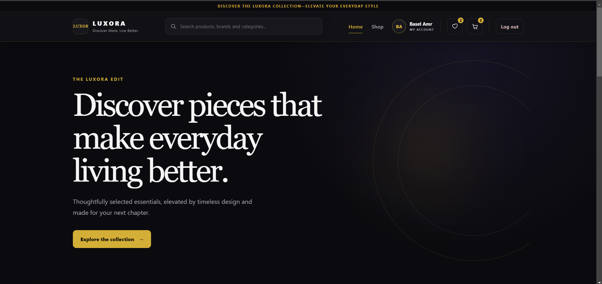
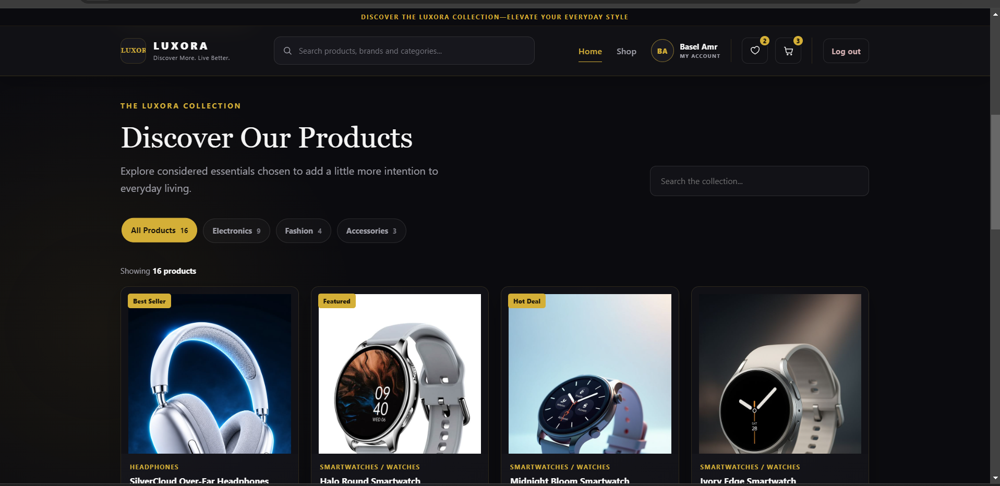
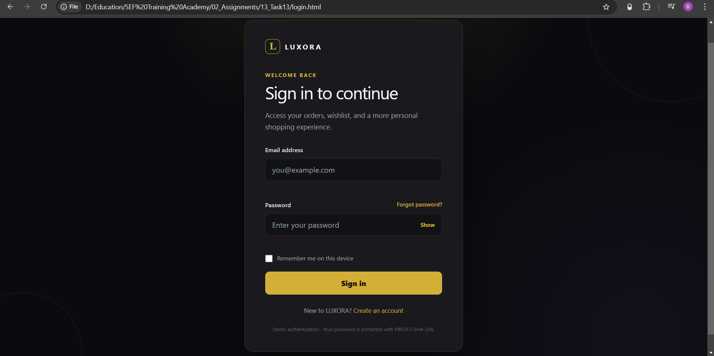
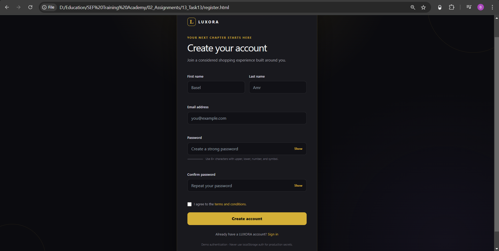
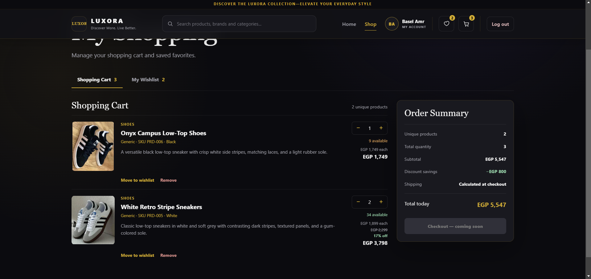
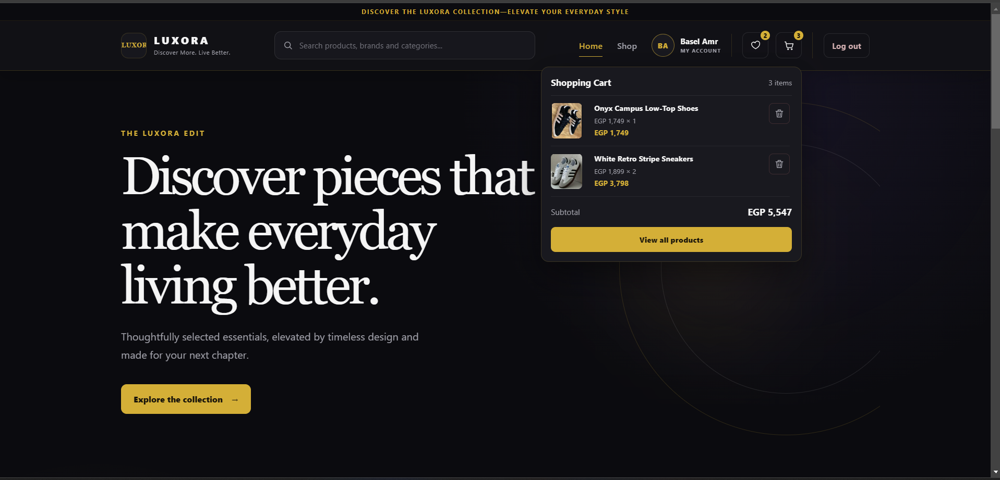
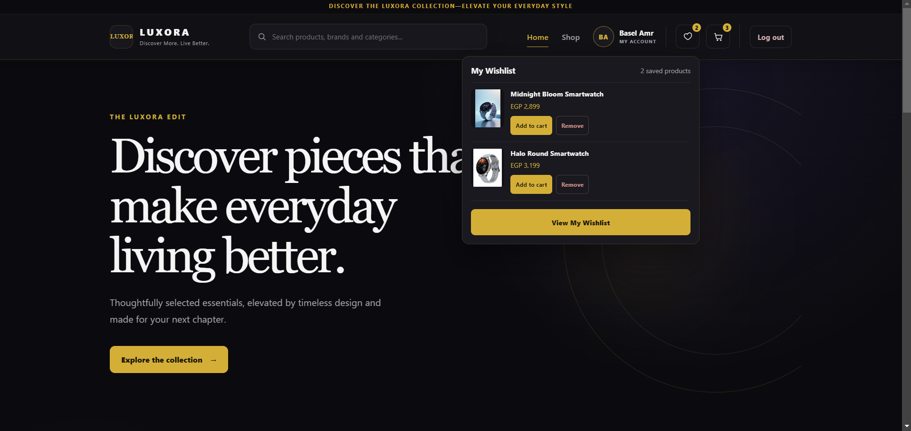

# LUXORA Store

### Discover More. Live Better.

LUXORA is a premium dark-themed e-commerce storefront built with semantic HTML, modern CSS, and vanilla JavaScript. It provides product discovery, category filtering, search, account registration and login, user-scoped cart and wishlist persistence, shopping previews, and a dedicated shopping page.

[](https://developer.mozilla.org/en-US/docs/Web/HTML)
[](https://developer.mozilla.org/en-US/docs/Web/CSS)
[](https://developer.mozilla.org/en-US/docs/Web/JavaScript)
[](https://tailwindcss.com/)

Repository: [Basel-Amr/luxora-ecommerce](https://github.com/Basel-Amr/luxora-ecommerce)

## Contents

- [Overview](#overview)
- [Screenshots and Demo](#screenshots-and-demo)
- [Features](#features)
- [Technologies](#technologies)
- [Getting Started](#getting-started)
- [Project Structure](#project-structure)
- [Architecture](#architecture)
- [User Workflow](#user-workflow)
- [Responsive Experience](#responsive-experience)
- [Testing and Quality](#testing-and-quality)
- [Limitations and Future Improvements](#limitations-and-future-improvements)
- [Learning Outcomes](#learning-outcomes)
- [Author](#author)
- [License](#license)

## Overview

LUXORA is a frontend e-commerce demo for browsing a curated catalog of fashion, accessories, and electronics. The interface is designed around a luxury storefront aesthetic: near-black surfaces, restrained gold accents, soft borders, responsive layouts, and focused shopping interactions.

The primary shopping flow is:

1. Browse the collection on the homepage.
2. Search by product title, brand, category, subcategory, description, color, or tag.
3. Narrow results with category filters.
4. Sign in or create an account before saving products.
5. Add products to a user-specific cart or wishlist.
6. Review quick cart and wishlist previews from the header, or manage both on the shopping page.

## Screenshots and Demo

### Homepage



### Product Collection



### Authentication





### Shopping Experience







The repository also includes a recorded walkthrough: [open the demo video](./Output/demo_video.mp4).

## Features

### Storefront and Navigation

- Premium LUXORA branding with announcement strip and slogan.
- Sticky responsive header with Home, Shop, search, authentication actions, cart, and wishlist controls.
- Responsive mobile navigation with click-outside and Escape-key closing behavior.
- Logo fallback when the optional image asset is unavailable.
- Toast feedback for shopping actions and account events.

### Product Discovery

- Catalog of 16 sample products covering Electronics, Fashion, and Accessories.
- Search across title, brand, category, subcategory, description, color, and tags.
- Category filters with result counts.
- Product cards with images, fallback handling, ratings, prices, discounts, stock, badges, and actions.
- Header search synchronized with the existing product search instead of creating a second search engine.

### Authentication

- Account registration with first name, last name, email, password confirmation, and validation feedback.
- Password strength feedback during registration.
- Login and logout flows using the existing `auth` utility.
- Password hashing with PBKDF2-SHA-256 through the browser Web Crypto API.
- Safe logged-in user data stored separately from password hashes.
- Authenticated header profile with dynamically generated initials and user name.

### Cart and Wishlist

- User-scoped cart and wishlist persistence in `localStorage`.
- Quantity-aware cart badges and wishlist counters.
- Quick cart and wishlist dropdown previews.
- Add, remove, quantity update, and move-to-wishlist interactions.
- Stock validation and prevention of quantities above available stock.
- Only one header dropdown opens at a time.

## Technologies

| Area              | Implementation                                                     |
| ----------------- | ------------------------------------------------------------------ |
| Markup            | HTML5 semantic pages                                               |
| Styling           | CSS3, custom properties, responsive media queries, CSS transitions |
| Application logic | Vanilla JavaScript with classic deferred scripts                   |
| Authentication    | Browser Web Crypto API with PBKDF2-SHA-256                         |
| Persistence       | Browser `localStorage`                                             |
| Utility styling   | Tailwind CSS CDN on the authentication pages                       |
| Icons             | Inline SVG icons for shopping and navigation controls              |
| Catalog           | Static JavaScript data exposed through `window.products`           |

There is no package manager configuration, bundler, framework runtime, backend, database, or external product API in this repository.

## Getting Started

### Prerequisites

- A modern browser with Web Crypto API support.
- Optional: Python, Node.js, or another static-file server for local development.

### Run locally

Clone the repository and enter the project directory:

```bash
git clone https://github.com/Basel-Amr/luxora-ecommerce.git
cd luxora-ecommerce
```

No dependency installation is required. Serve the project as static files. For example, with Python:

```bash
python -m http.server 8000
```

Open [http://localhost:8000](http://localhost:8000) in a browser.

You can also open `index.html` directly, but a local server is recommended for the most consistent asset loading and browser behavior.

### Main pages

| Page         | Path                 | Purpose                                       |
| ------------ | -------------------- | --------------------------------------------- |
| Homepage     | `index.html`         | Hero, search, filters, and product collection |
| Sign in      | `login.html`         | Existing-user authentication                  |
| Registration | `register.html`      | New-account creation and validation           |
| Shopping     | `cartsproducts.html` | Cart and wishlist management                  |

## Project Structure

```text
luxora-ecommerce/
├── index.html
├── login.html
├── register.html
├── cartsproducts.html
├── css/
│   ├── home.css
│   ├── products.css
│   ├── shopping-page.css
│   ├── login.css
│   ├── register.css
│   ├── all.css
│   └── style.css
├── js/
│   ├── auth.js
│   ├── home.js
│   ├── login.js
│   ├── register.js
│   ├── products.js
│   ├── storage/
│   │   └── shopping-storage.js
│   ├── components/
│   │   ├── cart-dropdown.js
│   │   ├── wishlist-dropdown.js
│   │   ├── product-card.js
│   │   └── toast.js
│   └── pages/
│       ├── home-products.js
│       └── shopping-page.js
├── images/products/
├── webfonts/
├── Output/
└── README.md
```

## Architecture

The project uses a small, page-oriented JavaScript architecture with classic script tags. Shared behavior is exposed through the `window` object because the application does not use ES modules or a build step.

- `products.js` owns the static catalog and product lookup helpers.
- `auth.js` owns registration, login, validation helpers, password hashing, and logout.
- `shopping-storage.js` owns user identity lookup and user-scoped cart/favorites operations.
- `home.js` renders the shared header, authentication actions, profile summary, responsive navigation, counters, and logo fallback.
- `home-products.js` renders filters and product cards and connects product actions to storage.
- `shopping-page.js` renders the full cart and wishlist page.
- `cart-dropdown.js` and `wishlist-dropdown.js` progressively enhance dynamically rendered header controls.
- Components communicate through custom events such as `luxora:cart-updated`, `luxora:favorites-updated`, and `luxora:dropdown-open`.

### Persistence model

Authenticated shopping data is keyed by normalized user email:

```text
luxora_cart_<encoded-email>
luxora_favorites_<encoded-email>
```

This keeps cart and wishlist data separated between users in the same browser. Logging out removes the active session marker and logged-in user object; it does not clear registered users, carts, or wishlists.

## User Workflow

1. A visitor can browse and search the public catalog without signing in.
2. A visitor attempting to save or purchase a product is prompted to authenticate.
3. Registration validates names, email, and password strength before storing the account record.
4. Login verifies the stored password hash and writes a safe session user object.
5. Cart and wishlist actions update user-scoped storage and dispatch UI update events.
6. The header counters and dropdown previews react to those events.
7. The shopping page provides full cart quantity controls, removal, subtotal calculation, and wishlist management.

## Responsive Experience

The UI includes responsive layouts for the storefront, header, product grid, authentication pages, and shopping page.

- Desktop layouts provide full branding, search, navigation, and product action previews.
- Tablet layouts reduce spacing and grid density.
- Mobile layouts use a compact brand row, full-width search, hamburger navigation, touch-friendly controls, and fixed-width-safe dropdown previews.
- Product grids move from two columns on narrow screens to three and four columns at larger breakpoints.
- Focus styles, accessible labels, live regions, and reduced-motion handling are included where implemented.

## Testing and Quality

No automated test framework or build script is configured in the repository. The project is validated through manual browser workflows.

Recommended manual checks:

- Browse, search, clear search, and filter the catalog.
- Register a new user, sign in, and sign out.
- Add and remove products from the cart and wishlist.
- Confirm user-specific persistence after refresh and logout.
- Open each header dropdown and verify click-outside/Escape behavior.
- Test the header and product grid at mobile, tablet, and desktop widths.
- Confirm product images and fallback states load correctly.

The authentication page itself labels the current implementation as demo authentication. It should not be treated as a production identity system without a server-side session architecture and additional security controls.

## Limitations and Future Improvements

The following are potential improvements, not current features:

- Replace the static catalog with a backend or commerce API.
- Move authentication and password verification to a server-side system.
- Add automated unit, integration, and end-to-end tests.
- Add checkout, payment processing, order history, and account management.
- Add a formal deployment configuration and live demo URL.
- Add a project license.
- Add dedicated mobile screenshots to the documentation set.

## Learning Outcomes

This project demonstrates practice with:

- Semantic multi-page HTML structure.
- Responsive CSS layout and design tokens.
- Vanilla JavaScript component composition without a framework.
- Browser storage design for user-scoped shopping state.
- Web Crypto API password hashing.
- Accessible interaction patterns such as labels, live regions, keyboard dismissal, and button states.
- Event-driven coordination between shared UI components and page renderers.

## Author

**Basel Amr**  
Frontend / Full Stack Developer  
Cairo, Egypt

- GitHub: [Basel-Amr](https://github.com/Basel-Amr)
- LinkedIn: [baselamrbarakat](https://www.linkedin.com/in/baselamrbarakat)
- HackerRank: [BaselAmr1998](https://www.hackerrank.com/profile/BaselAmr1998)
- Kaggle: [baselamr1998](https://www.kaggle.com/baselamr1998)

## License

No license has been specified for this project yet.
